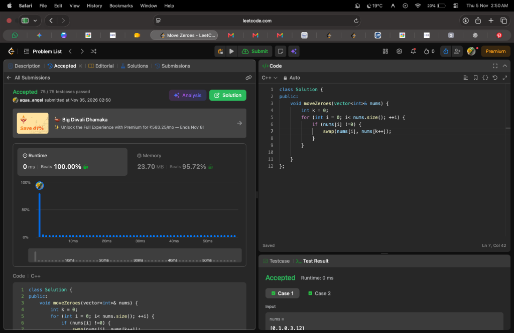

# 📌 LeetCode #283: Move Zeroes

- **Difficulty**: Easy
- **Topic**: Arrays, Two Pointers
- **Pattern**: Slow & Fast Pointers (In-Place Overwrite)
- **LeetCode Link**: [Move Zeroes](https://leetcode.com/problems/move-zeroes/)
- **Verdict**: Accepted (0 ms ⚡, Beats 100.00% Runtime, Beats 95.72% Memory 🔥)

---

## 📝 Problem Statement
Given an integer array `nums`, move all `0`'s to the end of it while maintaining the relative order of the non-zero elements.

**Note**: You must do this **in-place** without making a copy of the array.

### Examples
- **Example 1**:
  - **Input**: `nums = [0, 1, 0, 3, 12]`
  - **Output**: `[1, 3, 12, 0, 0]`
- **Example 2**:
  - **Input**: `nums = [0]`
  - **Output**: `[0]`

---

## 💡 What Is Happening Under The Hood?

### 1. Two-Pointer Partitioning Invariant
We use two pointers:
- `k` (slow pointer / boundary): marks the boundary for the next non-zero position.
- `i` (fast pointer / scout): iterates through the array from left to right.

At any point during the loop:
$$\text{nums}[0 \dots k-1] \implies \text{all non-zero elements in original relative order}$$
$$\text{nums}[k \dots i-1] \implies \text{all zeroes encountered so far}$$
$$\text{nums}[i \dots N-1] \implies \text{unprocessed elements}$$

### 2. The Swap Mechanics
Whenever `nums[i] != 0`:
- We execute `swap(nums[i], nums[k++])`.
- If $i == k$ (no zeroes have been encountered yet), an element simply swaps with itself (no-op).
- The moment a zero is encountered, $k$ stays behind at the index of that zero, while $i$ continues forward looking for the next non-zero number.
- When $i$ finds a non-zero, swapping `nums[i]` and `nums[k]` puts the non-zero at $k$ and pushes the zero forward to $i$!

```
nums = [0, 1, 0, 3, 12]

Start: k=0, i=0: nums[0]==0 ──► Skip (k stays at 0)
i=1:   nums[1]==1 != 0      ──► swap(nums[1], nums[0]) ──► [1, 0, 0, 3, 12], k becomes 1
i=2:   nums[2]==0           ──► Skip (k stays at 1)
i=3:   nums[3]==3 != 0      ──► swap(nums[3], nums[1]) ──► [1, 3, 0, 0, 12], k becomes 2
i=4:   nums[4]==12 != 0     ──► swap(nums[4], nums[2]) ──► [1, 3, 12, 0, 0], k becomes 3 ✅
```

---

## 💻 Solutions

### C++ (Your 0 ms, 100% Optimal Solution)
```cpp
#include <vector>
#include <algorithm>

using namespace std;

class Solution {
public:
    void moveZeroes(vector<int>& nums) {
        int k = 0;
        for (int i = 0; i < nums.size(); ++i) {
            if (nums[i] != 0) {
                swap(nums[i], nums[k++]);
            }
        }
    }
};
```

### Python 3
```python
class Solution:
    def moveZeroes(self, nums: list[int]) -> None:
        k = 0
        for i in range(len(nums)):
            if nums[i] != 0:
                nums[k], nums[i] = nums[i], nums[k]
                k += 1
```

### Java
```java
class Solution {
    public void moveZeroes(int[] nums) {
        int k = 0;
        for (int i = 0; i < nums.length; i++) {
            if (nums[i] != 0) {
                int temp = nums[k];
                nums[k] = nums[i];
                nums[i] = temp;
                k++;
            }
        }
    }
}
```

---

## 🔍 Dry-Run Table

Input: `nums = [0, 1, 0, 3, 12]`

| Step ($i$) | `nums[i]` | Condition `!= 0` | Pointer `k` Before | Action | Array After Step | Pointer `k` After |
| :-: | :-: | :-: | :-: | :--- | :--- | :-: |
| `0` | `0` | ❌ No | `0` | None | `[0, 1, 0, 3, 12]` | `0` |
| `1` | `1` | ✅ Yes | `0` | `swap(nums[1], nums[0])` | `[1, 0, 0, 3, 12]` | `1` |
| `2` | `0` | ❌ No | `1` | None | `[1, 0, 0, 3, 12]` | `1` |
| `3` | `3` | ✅ Yes | `1` | `swap(nums[3], nums[1])` | `[1, 3, 0, 0, 12]` | `2` |
| `4` | `12` | ✅ Yes | `2` | `swap(nums[4], nums[2])` | `[1, 3, 12, 0, 0]` | `3` |

---

## ⏱️ Complexity Analysis
- **Time Complexity**: $\mathcal{O}(N)$ — Exactly one linear pass through the array.
- **Space Complexity**: $\mathcal{O}(1)$ — Purely in-place modification with only two integer pointers.

---

## 🧠 Key Learnings & Mental Models to Remember

1. **Slow-Fast Pointer (Reader-Writer) Pattern**:
   - The fast pointer (`i`) explores and discovers valid elements.
   - The slow pointer (`k`) maintains the boundary of the processed, valid prefix.
2. **Connection to Dutch National Flag / Quicksort**:
   - `moveZeroes` is fundamentally a 2-way partition algorithm (non-zeroes to the left, zeroes to the right) while preserving stable relative order of non-zeroes.
3. **Where This Pattern Reappears**:
   - **Remove Element (LeetCode #27)**: Overwrite targets in-place using reader/writer pointers.
   - **Remove Duplicates from Sorted Array (LeetCode #26)**: Slow pointer writes unique elements as fast pointer scans.
   - **Sort Colors / Dutch National Flag (LeetCode #75)**: 3-way partition using low, mid, and high pointers.

---

## 📸 Submission Proof


