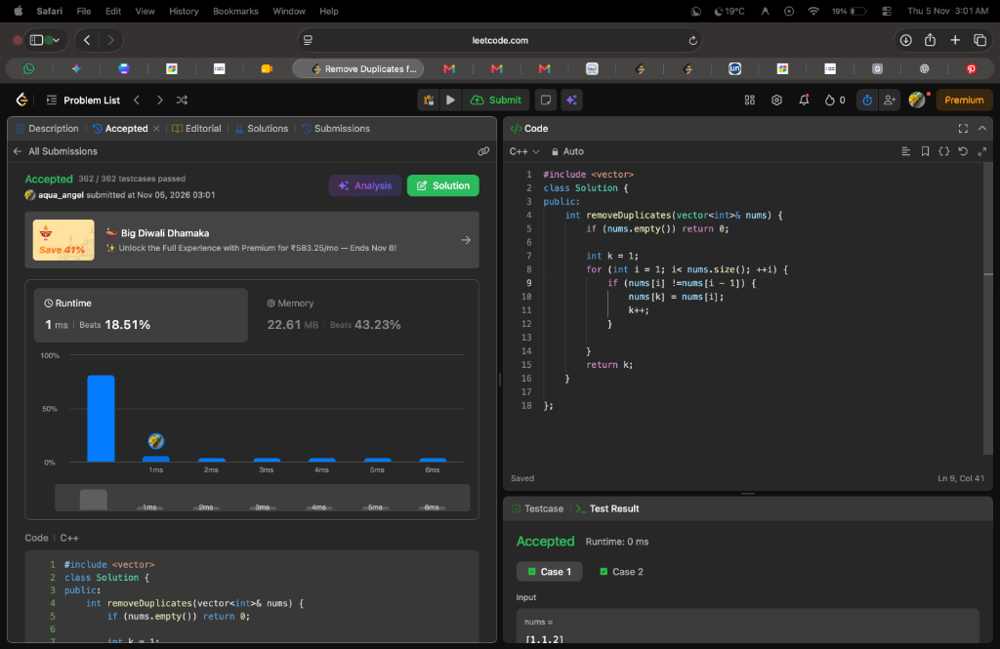

# 📌 LeetCode #26: Remove Duplicates from Sorted Array

- **Difficulty**: Easy
- **Topic**: Arrays, Two Pointers
- **Pattern**: Slow & Fast Pointers (Unique Boundary Tracking)
- **LeetCode Link**: [Remove Duplicates from Sorted Array](https://leetcode.com/problems/remove-duplicates-from-sorted-array/)
- **Verdict**: Accepted (1 ms ⚡, 362 / 362 testcases passed)

---

## 📝 Problem Statement
Given an integer array `nums` sorted in **non-decreasing order**, remove the duplicates **in-place** such that each unique element appears only once. The relative order of the elements should be kept the same. Then return the number of unique elements in `nums`.

Consider the number of unique elements to be `k`. To pass, you must:
1. Modify `nums` such that the first `k` elements contain the unique numbers in order.
2. Return `k`.

### Examples
- **Example 1**:
  - **Input**: `nums = [1, 1, 2]`
  - **Output**: `2, nums = [1, 2, _]`
- **Example 2**:
  - **Input**: `nums = [0, 0, 1, 1, 1, 2, 2, 3, 3, 4]`
  - **Output**: `5, nums = [0, 1, 2, 3, 4, _, _, _, _, _]`

---

## 💡 What Is Happening Under The Hood?

### 1. Exploiting the Sorted Invariant
Because `nums` is sorted in non-decreasing order:
$$\text{nums}[0] \le \text{nums}[1] \le \text{nums}[2] \le \dots \le \text{nums}[N-1]$$
Any duplicate instances of a number are **strictly adjacent** to each other. An element is a new unique number if and only if:
$$\text{nums}[i] \neq \text{nums}[i - 1]$$

### 2. Slow-Fast Reader/Writer Pointers
- `k = 1`: Index where the next unique number should be written. (The first element `nums[0]` is always unique and stays at index 0).
- `i = 1`: Fast explorer pointer that scans the rest of the array.

At every step of iteration:
$$\text{nums}[0 \dots k - 1] \implies \text{strictly unique elements in sorted order}$$
$$\text{nums}[k \dots i - 1] \implies \text{overwritten duplicates / unused prefix}$$
$$\text{nums}[i \dots N - 1] \implies \text{unprocessed elements}$$

```
nums = [0, 0, 1, 1, 1, 2, 2, 3, 3, 4]

i=1: nums[1]==0 == nums[0] ──► Duplicate! Skip (k stays at 1)
i=2: nums[2]==1 != nums[1] ──► New unique! nums[k]=1, k becomes 2 ──► [0, 1, ...]
i=3: nums[3]==1 == nums[2] ──► Duplicate! Skip
i=4: nums[4]==1 == nums[3] ──► Duplicate! Skip
i=5: nums[5]==2 != nums[4] ──► New unique! nums[k]=2, k becomes 3 ──► [0, 1, 2, ...]
...
Final: k = 5, unique prefix = [0, 1, 2, 3, 4] ⚡
```

---

## 💻 Solutions

### C++ (Your Accepted Solution - 1 ms)
```cpp
#include <vector>

using namespace std;

class Solution {
public:
    int removeDuplicates(vector<int>& nums) {
        if (nums.empty()) return 0;
        
        int k = 1;
        for (int i = 1; i < nums.size(); ++i) {
            // New unique element detected
            if (nums[i] != nums[i - 1]) {
                nums[k] = nums[i];
                k++;
            }
        }
        return k;
    }
};
```

### Python 3
```python
class Solution:
    def removeDuplicates(self, nums: list[int]) -> int:
        if not nums:
            return 0
            
        k = 1
        for i in range(1, len(nums)):
            if nums[i] != nums[i - 1]:
                nums[k] = nums[i]
                k += 1
        return k
```

### Java
```java
class Solution {
    public int removeDuplicates(int[] nums) {
        if (nums.length == 0) return 0;
        
        int k = 1;
        for (int i = 1; i < nums.length; i++) {
            if (nums[i] != nums[i - 1]) {
                nums[k] = nums[i];
                k++;
            }
        }
        return k;
    }
}
```

---

## 🔍 Dry-Run Table

Input: `nums = [0, 0, 1, 1, 2]`

| Step ($i$) | `nums[i]` | `nums[i-1]` | `nums[i] != nums[i-1]`? | Action | `nums` Array After Step | `k` After |
| :-: | :-: | :-: | :-: | :--- | :--- | :-: |
| — | — | — | — | Initial state | `[0, 0, 1, 1, 2]` | `1` |
| `1` | `0` | `0` | ❌ No | Duplicate $\rightarrow$ skip | `[0, 0, 1, 1, 2]` | `1` |
| `2` | `1` | `0` | ✅ Yes | `nums[1] = 1; k++` | `[0, 1, 1, 1, 2]` | `2` |
| `3` | `1` | `1` | ❌ No | Duplicate $\rightarrow$ skip | `[0, 1, 1, 1, 2]` | `2` |
| `4` | `2` | `1` | ✅ Yes | `nums[2] = 2; k++` | `[0, 1, 2, 1, 2]` | `3` |

**Return value**: `k = 3` (Prefix is `[0, 1, 2]`).

---

## ⏱️ Complexity Analysis
- **Time Complexity**: $\mathcal{O}(N)$ — Single pass through the array of length $N$.
- **Space Complexity**: $\mathcal{O}(1)$ — Purely in-place pointer manipulation with zero extra memory allocated.

---

## 🧠 Key Learnings & Mental Models to Remember

1. **Two Pointers In-Place Array Mutation**:
   - `k` holds the **writer** position (always points to the end of the clean, valid subarray).
   - `i` acts as the **scout** scanning the raw input array.
2. **Generalization: Allow at most $M$ duplicates (e.g. LeetCode #80)**:
   - For at most $M = 1$ duplicate (this problem): compare with `nums[k - 1]`.
   - For at most $M = 2$ duplicates (LeetCode #80): compare with `nums[k - 2]`:
     ```cpp
     for (int n : nums) {
         if (k < 2 || n > nums[k - 2]) {
             nums[k++] = n;
         }
     }
     ```
   - This single template solves **all** "remove duplicates up to $M$ times" problems!
3. **Where This Pattern Reappears**:
   - **Move Zeroes (LeetCode #283)**: Writer pointer advances on non-zeroes.
   - **Remove Element (LeetCode #27)**: Writer pointer advances on non-target elements.
   - **Remove Duplicates from Sorted Array II (LeetCode #80)**: Writer pointer advances if $nums[i] > nums[k-2]$.

---

## 📸 Submission Proof


